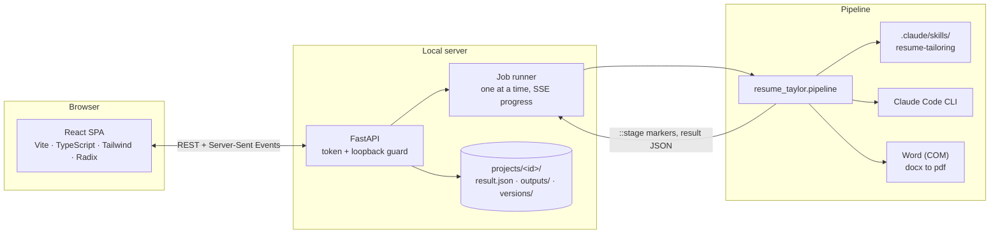

# Contributing and internals

This page is for people changing the code. If you just want to use Resume Taylor,
the [README](README.md) is all you need.

## Setup for development

You need Python 3.10+ and, only for changing the web app, Node.js 20+.

```bash
pip install -e "backend[dev]"
```
```bash
cd backend && python -m pytest -q
```
```bash
ruff check backend scripts examples
```
```bash
cd frontend && npm install && npm run check
```

- `npm run check` runs TypeScript, ESLint, and Vitest.
- `npm run gen:api` regenerates `src/lib/api/schema.d.ts` from the server's Pydantic
  models, so frontend and backend types can't drift.
- `python scripts/make_template_previews.py` re-renders the template thumbnails
  (needs Word).
- `python scripts/capture_screenshots.py` retakes these screenshots against a
  running demo workspace and fails if any page scrolls sideways on a phone.

No test makes a Claude call; the API tests swap in a fake pipeline script.


The web app is shipped prebuilt in `frontend/dist` so that end users do not
need Node.js. **After changing anything in `frontend/src`, run `npm run build`
and commit the updated `dist/`** (CI fails if it is stale). The launcher rebuilds
automatically for anyone who has run `npm install` (a `node_modules` folder exists).

Before committing, install the safety hook once. It blocks resumes, `.env`, API keys,
and project folders from being committed:

```bash
python scripts/check_no_personal_data.py --install-hook
```

## How it works



- **The pipeline stays the single source of truth.** The app keeps your inputs in
  the exact files the command-line pipeline reads (`in_profile*.docx`,
  `in_resume*.docx`, `fact_bank.yaml`, `do_not_claim.txt`), and runs
  the pipeline (`python -m resume_taylor.pipeline`) as a subprocess for every generation and re-render. The
  tailoring rules live only in the `resume-tailoring` skill.
- **Generation** is a drafting call plus a narrow JSON transcription call, followed by
  deterministic validation (citations, cross-employer mentions, numbers, em dashes,
  the never-claim list, keyword coverage). The result is saved as editable JSON.
- **Re-rendering** (`--render-json`) re-runs the same guards on your edited content
  and writes the files without calling Claude, so template switches and hand edits
  are instant and free.
- **Security for a local app:** the server binds to 127.0.0.1, rejects non-loopback
  Host headers (DNS rebinding), and requires a per-launch token on every API call.

## Repository map

```text
backend/                     the Python side (pip install -e backend)
  pyproject.toml             dependencies, console scripts, pytest config
  src/resume_taylor/
    layout.py, config.py     where things live; settings from the environment / .env
    claude_cli.py            running the `claude` CLI as a text-generation step
    launcher.py              starts the app and opens the browser (python -m resume_taylor)
    pipeline/                the tailoring engine (parsing, Claude calls, guards, output); no web code
      render/                templates, .docx builder, PDF export
    api/                     the FastAPI backend of the web app
      routers/               the HTTP API, one module per area
      services/              background jobs, pipeline runner, live checks, sample data, OS integration
      storage/               files on disk: projects, profile, resume import, facts, settings, paths
    sample_data/, resources/ the fictional demo applicant; the starter never-claim list
  tests/                     pipeline/ and api/ tests (no test makes a Claude call)
frontend/                    the React app (Vite + TypeScript); dist/ is committed
  src/features/              one folder per screen: XPage.tsx, components/, hooks/, small logic modules
  src/components/            ui/ (Radix wrappers), layout/ (app shell), shared/ (used by several screens)
  src/lib/                   API client + react-query hooks + SSE + types, routes, theme, utils
.claude/skills/              the tailoring rules (single source of truth)
docs/                        brand assets, README screenshots, cached resume best practices
examples/                    anonymized sample inputs (see examples/README.md)
scripts/                     dev and maintenance scripts (see scripts/README.md)
  windows/                   Doctor, Update and Create Desktop Shortcut helpers
workspace/                   git-ignored data for the command-line workflow: input/, output/, archive/
Launch Resume Taylor.bat     the double-click installer and launcher for non-technical users
```

See [CLAUDE.md](CLAUDE.md) for internals.

## Command-line use

The command-line pipeline works on its own, with `workspace/input/` as the inputs and
`workspace/output/` / `workspace/archive/` as the outputs. (Older checkouts used
`resume_input/`, `resume_create/` and `resume_archive/` at the repo root; move their
contents into the matching `workspace/` folders.)

```bash
python -m resume_taylor.pipeline   # or the installed command: resume-taylor-generate
```

| Flag | What it does |
|------|--------------|
| `--job PATH` | Tailor to this posting instead of the newest `workspace/input/in_job*` file |
| `--profile`, `--resume`, `--fact-bank`, `--deny` | Use these input files instead of the defaults |
| `--template {classic,modern,compact}` | Resume layout (default: classic) |
| `--cover-letter` | Also write a cover letter, held to the same citation and never-claim checks |
| `--no-analysis` | Skip the posting-analysis call and the one-time redraft (fewer Claude calls) |
| `--voice-pass` | Rewrite bullets that use generic phrasing in your own wording (one extra call; numbers must stay identical) |
| `--out-dir`, `--archive-dir` | Where outputs and superseded outputs go |
| `--result-json PATH` | Also save the structured, editable result |
| `--render-json PATH` | Re-validate and render a saved result without calling Claude |
| `--model M`, `--effort E` | Override `CLAUDE_MODEL` / `CLAUDE_EFFORT` |
| `--no-pdf`, `--dry-run`, `--archive-job` | Skip PDF export / write nothing / archive the posting after a run |

Optional inputs: `workspace/input/fact_bank.yaml` (draft it with
`resume-taylor-facts`, then edit by hand or in the app) and `do_not_claim.txt` in the repo
root (one case-insensitive regex per line). Optional `.env` settings: `CLAUDE_MODEL`,
`CLAUDE_EFFORT`, `CLAUDE_TIMEOUT`.
